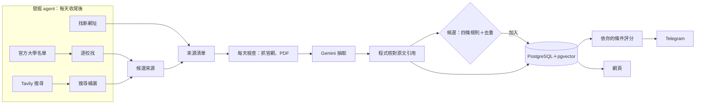

# 留學獎學金 Agent

[](https://github.com/JoeDunnoHowToCode/scholarship-agent/actions/workflows/ci.yml)

> An AI agent that collects European master's scholarships for a Taiwanese student: it discovers official sources on its own, extracts and verifies the details against the original page, scores each scholarship against the user's profile, and sends Telegram alerts. Python / FastAPI / PostgreSQL + pgvector / RQ / Gemini / React.

自動收集歐洲碩士獎學金的 AI agent：自己去官方網站找來源，抽出截止日、國籍資格、學位、金額，**用程式核對每一項在原文裡找得到依據**，依你的條件評分並說明理由，有新的、要截止的就用 Telegram 通知你。

目前是第一版：只有使用者本人，跑在本機（Mac）。

## 它做什麼

- **每天檢查**：約 250 個官方來源（Erasmus Mundus 學程、各國政府、大學），網頁和 PDF 都抓，內容沒變就不重抽
- **抽取＋核對**：Gemini 照 schema 抽取，每個關鍵欄位附逐字引用，程式確認引用真的在原文裡（ADR-008）
- **評分**：國籍、學位由程式判斷；領域契合由 AI 評，附一句理由（ADR-055、059）
- **發掘 agent**：
  - 每天逐校找：從英國與北歐的官方大學名單（320 所）出發，自己在學校網站裡找國際碩士獎學金頁
  - 每週搜尋補漏：找政府、基金會等大學以外的獎學金
  - 替不在了的網站找新官網（ADR-080、083、096）
- **品質把關**：agent 提交的只是候選，要通過四條規則與內容去重才加入（ADR-078、097）
- **通知**：新獎學金、新年度公布、截止提醒、資料變更、每日檢查報告（ADR-062、076、093）
- **網頁**：列表（篩選、混合搜尋）、詳細頁（每個欄位附原文與核對結果）、問答（附出處）、通知歷史、設定、紀錄

## 架構



- 固定流程用一般 Python 函式，由 RQ 背景工作串接；只有「發掘」用 agent（ADR-002、007、082）
- agent 迴圈自己寫（不用框架）：Gemini 函式呼叫，工具只有搜尋、讀網頁、提交三種，而且只能打開或提交這次看過的網址（ADR-082、084）
- 每次 AI 呼叫都記錄費用，達到每月上限（NT$7,000）就自動暫停（ADR-049、089）
- 個人資料只把科系與想讀的領域送給 AI；國籍等其他欄位只在本機用（ADR-055、087）

## 重要的設計決定

所有決定都記在 [docs/adr.md](docs/adr.md)（ADR-001 到 099），每一條寫了「決定、理由、後果」。幾個代表性的：

| 問題 | 做法 | ADR |
| --- | --- | --- |
| AI 抽錯怎麼辦 | 關鍵欄位附逐字引用，程式確認引用存在於原文，再由 AI 判斷引用撐不撐得起值 | 008、045 |
| 網頁每天都在變（更新時間、新聞） | 只看和獎學金有關的段落算指紋，沒變就不花錢重抽 | 079 |
| agent 被網頁上的指令騙 | 工具最小化、看不到個資、提交的只是候選，還要過規則與去重 | 084、078、097 |
| 怎麼知道換模型會不會比較好 | 固定樣本、同一份快照，比較有根據率、穩定度、一致率，再人工抽查不一致的地方 | 098 |
| 怎麼避免改壞 | TDD（紅燈、綠燈分開 commit）＋ GitHub Actions | 099 |

## 技術組合

| 層 | 用的東西 |
| --- | --- |
| 後端 | Python 3.13、FastAPI、SQLAlchemy 2、Alembic、RQ（Redis） |
| 資料庫 | PostgreSQL 17＋pgvector（Docker） |
| AI | Gemini 3.5 Flash-Lite（抽取、評分、agent）、gemini-embedding-2（向量），透過 LangChain 的轉接頭 |
| 搜尋 | Tavily |
| 前端 | React、TypeScript、Vite、TanStack Query、shadcn/ui |
| 通知 | Telegram Bot API |
| 檢查 | pytest（300 多個測試）、ruff、mypy、gitleaks（commit 前掃金鑰）、GitHub Actions |

## 在本機跑

需要：macOS、Docker Desktop、[uv](https://docs.astral.sh/uv/)、Node 22。

```bash
docker compose up -d                                   # PostgreSQL＋pgvector、Redis
cd backend
uv sync
uv run alembic upgrade head                            # 建資料表
uv run python -m app.features.sources.seed             # 3 個起始來源
uv run python -m app.features.discovery.universities --load   # 官方大學名單
```

金鑰寫進 `backend/.env`（不進 git）：

```
GOOGLE_API_KEY=…        # Gemini（付費方案，內容不用於改善產品）
TAVILY_API_KEY=…        # 發掘 agent 的搜尋
TELEGRAM_BOT_TOKEN=…    # 通知（先在 Telegram 對機器人按 Start，再執行 uv run python -m app.core.notify.setup）
```

```bash
uv run python -m app.features.pipeline.run              # 手動跑一次每天的檢查
uv run python -m app.features.pipeline.launchd install  # 登入後自動啟動 worker 與排程器
uv run uvicorn app.main:app                             # 網頁與 API（先在 frontend/ 執行 npm ci && npm run build）
```

檢查：

```bash
cd backend && uv run pytest && uv run ruff check . && uv run mypy app
cd frontend && npm run build
```

## 模型評估

（評估進行中，結果完成後補上）

## 費用

- 每天的檢查：只有相關段落變了才重抽（ADR-079），每次約 NT$0.2
- 發掘 agent：每次執行上限 NT$2，逐校找平均每所約 NT$0.4
- 每月上限 NT$7,000，到了就自動暫停 AI 步驟；網頁的「紀錄」頁看得到本月花了多少、哪個功能最花錢

## 文件

- [docs/spec.md](docs/spec.md)：規格摘要
- [docs/adr.md](docs/adr.md)：架構決策紀錄
- `docs/day-NN.md`：每一天的計畫與完成標準（附每一項的驗證結果）
- [docs/learning/](docs/learning/)：每一天的學習卡（做了什麼、為什麼、背後的概念）

## 資料與授權

- 抓下來的網頁、抽取結果與個人資料都只在本機的資料庫，不在這個 repo 裡
- 抓取遵守 robots.txt、每個網站限速、被擋就停，不偽裝成瀏覽器、不破解驗證碼（ADR-028）
- 來源的內容依各自的授權，例如 EACEA 為 CC BY 4.0、教育部為政府資料開放授權條款
