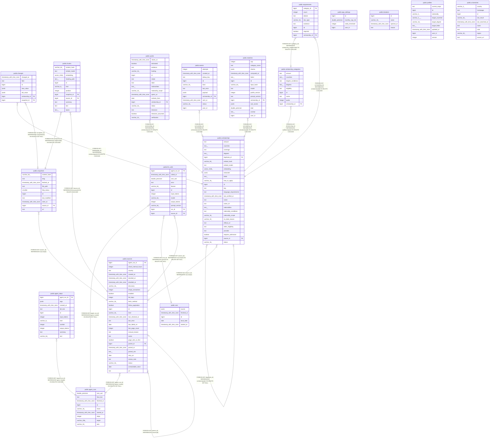

# scholar

## Tables

| Name | Columns | Comment | Type |
| ---- | ------- | ------- | ---- |
| [public.agent_runs](public.agent_runs.md) | 9 |  | BASE TABLE |
| [public.agent_steps](public.agent_steps.md) | 11 |  | BASE TABLE |
| [public.app_settings](public.app_settings.md) | 4 |  | BASE TABLE |
| [public.breakers](public.breakers.md) | 4 |  | BASE TABLE |
| [public.changes](public.changes.md) | 7 |  | BASE TABLE |
| [public.chunks](public.chunks.md) | 12 |  | BASE TABLE |
| [public.cycles](public.cycles.md) | 16 |  | BASE TABLE |
| [public.events](public.events.md) | 11 |  | BASE TABLE |
| [public.llm_calls](public.llm_calls.md) | 12 |  | BASE TABLE |
| [public.matches](public.matches.md) | 15 |  | BASE TABLE |
| [public.profiles](public.profiles.md) | 9 |  | BASE TABLE |
| [public.requirements](public.requirements.md) | 8 |  | BASE TABLE |
| [public.runs](public.runs.md) | 5 |  | BASE TABLE |
| [public.scholarship_categories](public.scholarship_categories.md) | 9 |  | BASE TABLE |
| [public.scholarships](public.scholarships.md) | 27 |  | BASE TABLE |
| [public.snapshots](public.snapshots.md) | 10 |  | BASE TABLE |
| [public.sources](public.sources.md) | 29 |  | BASE TABLE |
| [public.universities](public.universities.md) | 9 |  | BASE TABLE |

## Relations

---

> Generated by [tbls](https://github.com/k1LoW/tbls)
