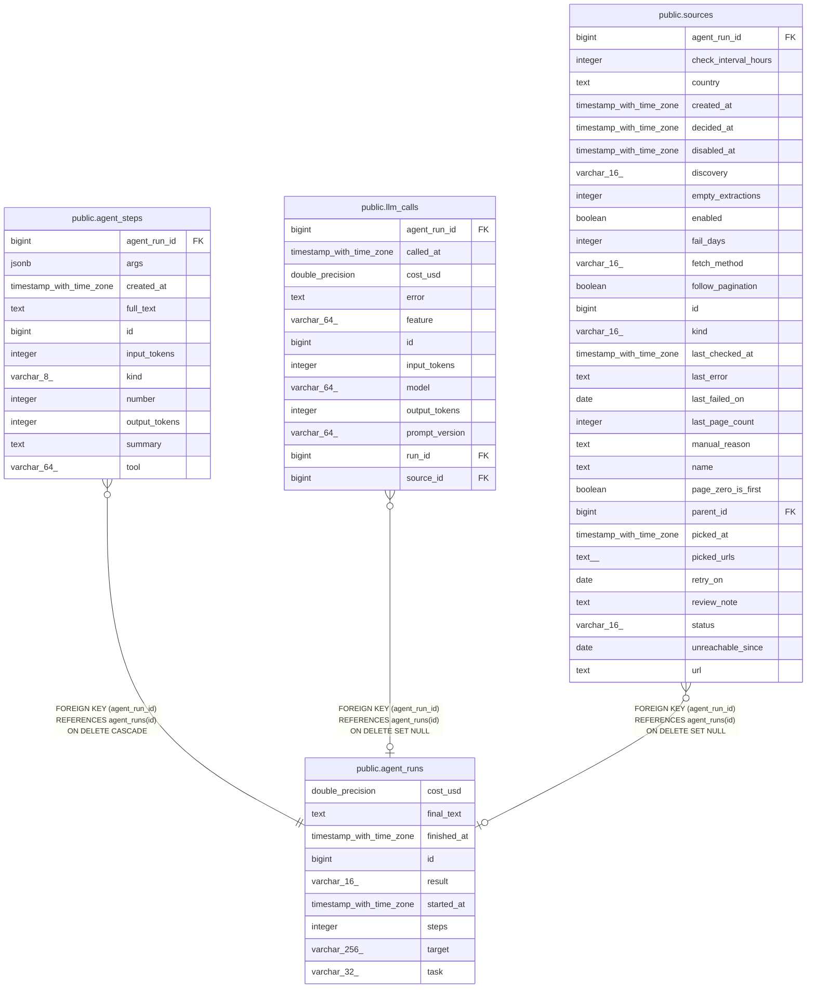

# public.agent_runs

## Columns

| Name | Type | Default | Nullable | Children | Parents | Comment |
| ---- | ---- | ------- | -------- | -------- | ------- | ------- |
| cost_usd | double precision | '0'::double precision | false |  |  |  |
| final_text | text |  | true |  |  |  |
| finished_at | timestamp with time zone |  | true |  |  |  |
| id | bigint |  | false | [public.agent_steps](public.agent_steps.md) [public.llm_calls](public.llm_calls.md) [public.sources](public.sources.md) |  |  |
| result | varchar(16) |  | true |  |  |  |
| started_at | timestamp with time zone | now() | false |  |  |  |
| steps | integer | 0 | false |  |  |  |
| target | varchar(256) |  | true |  |  |  |
| task | varchar(32) |  | false |  |  |  |

## Constraints

| Name | Type | Definition |
| ---- | ---- | ---------- |
| agent_runs_pkey | PRIMARY KEY | PRIMARY KEY (id) |

## Indexes

| Name | Definition |
| ---- | ---------- |
| agent_runs_pkey | CREATE UNIQUE INDEX agent_runs_pkey ON public.agent_runs USING btree (id) |
| ix_agent_runs_started_at | CREATE INDEX ix_agent_runs_started_at ON public.agent_runs USING btree (started_at) |

## Relations

---

> Generated by [tbls](https://github.com/k1LoW/tbls)
