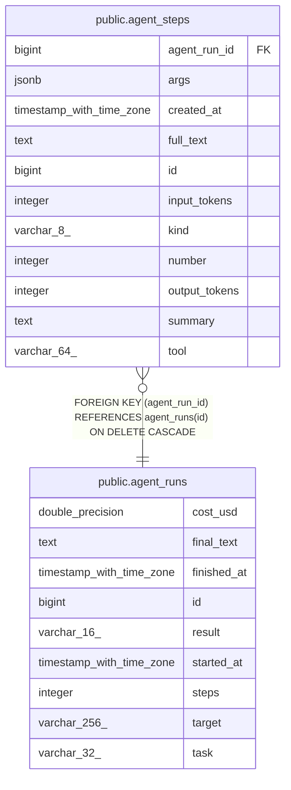

# public.agent_steps

## Columns

| Name | Type | Default | Nullable | Children | Parents | Comment |
| ---- | ---- | ------- | -------- | -------- | ------- | ------- |
| agent_run_id | bigint |  | false |  | [public.agent_runs](public.agent_runs.md) |  |
| args | jsonb |  | true |  |  |  |
| created_at | timestamp with time zone | now() | false |  |  |  |
| full_text | text |  | true |  |  |  |
| id | bigint |  | false |  |  |  |
| input_tokens | integer | 0 | false |  |  |  |
| kind | varchar(8) |  | false |  |  |  |
| number | integer |  | false |  |  |  |
| output_tokens | integer | 0 | false |  |  |  |
| summary | text |  | false |  |  |  |
| tool | varchar(64) |  | true |  |  |  |

## Constraints

| Name | Type | Definition |
| ---- | ---- | ---------- |
| agent_steps_agent_run_id_fkey | FOREIGN KEY | FOREIGN KEY (agent_run_id) REFERENCES agent_runs(id) ON DELETE CASCADE |
| agent_steps_pkey | PRIMARY KEY | PRIMARY KEY (id) |

## Indexes

| Name | Definition |
| ---- | ---------- |
| agent_steps_pkey | CREATE UNIQUE INDEX agent_steps_pkey ON public.agent_steps USING btree (id) |
| ix_agent_steps_agent_run_id | CREATE INDEX ix_agent_steps_agent_run_id ON public.agent_steps USING btree (agent_run_id) |
| ix_agent_steps_created_at | CREATE INDEX ix_agent_steps_created_at ON public.agent_steps USING btree (created_at) |

## Relations

---

> Generated by [tbls](https://github.com/k1LoW/tbls)
