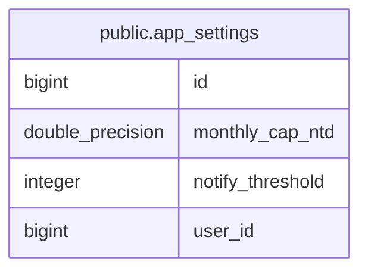

# public.app_settings

## Columns

| Name | Type | Default | Nullable | Children | Parents | Comment |
| ---- | ---- | ------- | -------- | -------- | ------- | ------- |
| id | bigint |  | false |  |  |  |
| monthly_cap_ntd | double precision |  | true |  |  |  |
| notify_threshold | integer |  | true |  |  |  |
| user_id | bigint |  | false |  |  |  |

## Constraints

| Name | Type | Definition |
| ---- | ---- | ---------- |
| app_settings_pkey | PRIMARY KEY | PRIMARY KEY (id) |
| app_settings_user_id_key | UNIQUE | UNIQUE (user_id) |

## Indexes

| Name | Definition |
| ---- | ---------- |
| app_settings_pkey | CREATE UNIQUE INDEX app_settings_pkey ON public.app_settings USING btree (id) |
| app_settings_user_id_key | CREATE UNIQUE INDEX app_settings_user_id_key ON public.app_settings USING btree (user_id) |

## Relations

---

> Generated by [tbls](https://github.com/k1LoW/tbls)
