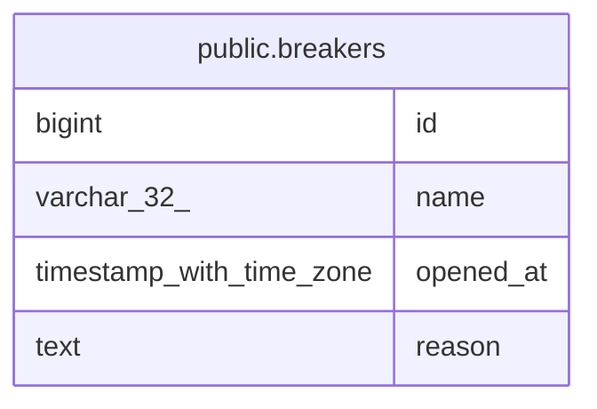

# public.breakers

## Columns

| Name | Type | Default | Nullable | Children | Parents | Comment |
| ---- | ---- | ------- | -------- | -------- | ------- | ------- |
| id | bigint |  | false |  |  |  |
| name | varchar(32) |  | false |  |  |  |
| opened_at | timestamp with time zone |  | true |  |  |  |
| reason | text |  | true |  |  |  |

## Constraints

| Name | Type | Definition |
| ---- | ---- | ---------- |
| breakers_name_key | UNIQUE | UNIQUE (name) |
| breakers_pkey | PRIMARY KEY | PRIMARY KEY (id) |

## Indexes

| Name | Definition |
| ---- | ---------- |
| breakers_name_key | CREATE UNIQUE INDEX breakers_name_key ON public.breakers USING btree (name) |
| breakers_pkey | CREATE UNIQUE INDEX breakers_pkey ON public.breakers USING btree (id) |

## Relations

---

> Generated by [tbls](https://github.com/k1LoW/tbls)
