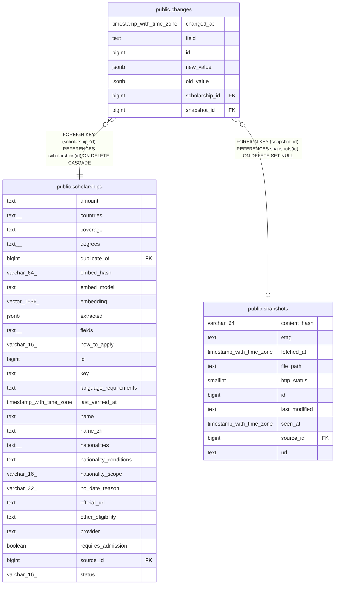

# public.changes

## Columns

| Name | Type | Default | Nullable | Children | Parents | Comment |
| ---- | ---- | ------- | -------- | -------- | ------- | ------- |
| changed_at | timestamp with time zone |  | false |  |  |  |
| field | text |  | false |  |  |  |
| id | bigint |  | false |  |  |  |
| new_value | jsonb |  | false |  |  |  |
| old_value | jsonb |  | false |  |  |  |
| scholarship_id | bigint |  | false |  | [public.scholarships](public.scholarships.md) |  |
| snapshot_id | bigint |  | true |  | [public.snapshots](public.snapshots.md) |  |

## Constraints

| Name | Type | Definition |
| ---- | ---- | ---------- |
| changes_pkey | PRIMARY KEY | PRIMARY KEY (id) |
| changes_scholarship_id_fkey | FOREIGN KEY | FOREIGN KEY (scholarship_id) REFERENCES scholarships(id) ON DELETE CASCADE |
| changes_snapshot_id_fkey | FOREIGN KEY | FOREIGN KEY (snapshot_id) REFERENCES snapshots(id) ON DELETE SET NULL |

## Indexes

| Name | Definition |
| ---- | ---------- |
| changes_pkey | CREATE UNIQUE INDEX changes_pkey ON public.changes USING btree (id) |

## Relations

---

> Generated by [tbls](https://github.com/k1LoW/tbls)
