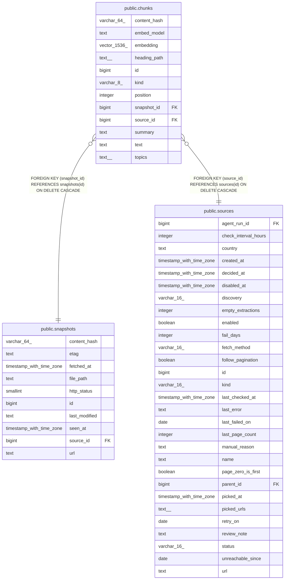

# public.chunks

## Columns

| Name | Type | Default | Nullable | Children | Parents | Comment |
| ---- | ---- | ------- | -------- | -------- | ------- | ------- |
| content_hash | varchar(64) |  | false |  |  |  |
| embed_model | text |  | true |  |  |  |
| embedding | vector(1536) |  | true |  |  |  |
| heading_path | text[] | '{}'::text[] | false |  |  |  |
| id | bigint |  | false |  |  |  |
| kind | varchar(8) |  | false |  |  |  |
| position | integer |  | false |  |  |  |
| snapshot_id | bigint |  | false |  | [public.snapshots](public.snapshots.md) |  |
| source_id | bigint |  | false |  | [public.sources](public.sources.md) |  |
| summary | text |  | true |  |  |  |
| text | text |  | false |  |  |  |
| topics | text[] | '{}'::text[] | false |  |  |  |

## Constraints

| Name | Type | Definition |
| ---- | ---- | ---------- |
| chunks_pkey | PRIMARY KEY | PRIMARY KEY (id) |
| chunks_snapshot_id_fkey | FOREIGN KEY | FOREIGN KEY (snapshot_id) REFERENCES snapshots(id) ON DELETE CASCADE |
| chunks_source_id_fkey | FOREIGN KEY | FOREIGN KEY (source_id) REFERENCES sources(id) ON DELETE CASCADE |

## Indexes

| Name | Definition |
| ---- | ---------- |
| chunks_pkey | CREATE UNIQUE INDEX chunks_pkey ON public.chunks USING btree (id) |

## Relations

---

> Generated by [tbls](https://github.com/k1LoW/tbls)
