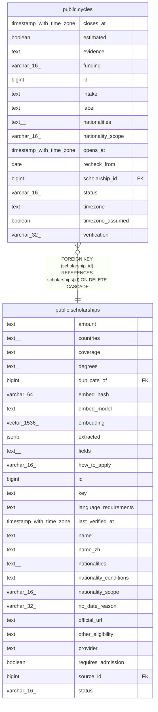

# public.cycles

## Columns

| Name | Type | Default | Nullable | Children | Parents | Comment |
| ---- | ---- | ------- | -------- | -------- | ------- | ------- |
| closes_at | timestamp with time zone |  | false |  |  |  |
| estimated | boolean | false | false |  |  |  |
| evidence | text |  | true |  |  |  |
| funding | varchar(16) | 'any'::character varying | false |  |  |  |
| id | bigint |  | false |  |  |  |
| intake | text |  | true |  |  |  |
| label | text |  | true |  |  |  |
| nationalities | text[] | '{}'::text[] | false |  |  |  |
| nationality_scope | varchar(16) | 'all'::character varying | false |  |  |  |
| opens_at | timestamp with time zone |  | true |  |  |  |
| recheck_from | date |  | true |  |  |  |
| scholarship_id | bigint |  | false |  | [public.scholarships](public.scholarships.md) |  |
| status | varchar(16) |  | false |  |  |  |
| timezone | text |  | true |  |  |  |
| timezone_assumed | boolean | false | false |  |  |  |
| verification | varchar(32) |  | true |  |  |  |

## Constraints

| Name | Type | Definition |
| ---- | ---- | ---------- |
| cycles_pkey | PRIMARY KEY | PRIMARY KEY (id) |
| cycles_scholarship_id_fkey | FOREIGN KEY | FOREIGN KEY (scholarship_id) REFERENCES scholarships(id) ON DELETE CASCADE |

## Indexes

| Name | Definition |
| ---- | ---------- |
| cycles_pkey | CREATE UNIQUE INDEX cycles_pkey ON public.cycles USING btree (id) |

## Relations

---

> Generated by [tbls](https://github.com/k1LoW/tbls)
