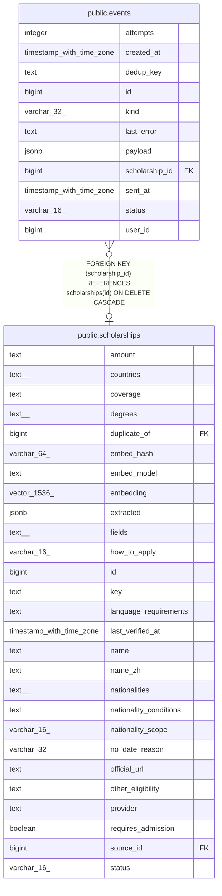

# public.events

## Columns

| Name | Type | Default | Nullable | Children | Parents | Comment |
| ---- | ---- | ------- | -------- | -------- | ------- | ------- |
| attempts | integer | 0 | false |  |  |  |
| created_at | timestamp with time zone |  | false |  |  |  |
| dedup_key | text |  | false |  |  |  |
| id | bigint |  | false |  |  |  |
| kind | varchar(32) |  | false |  |  |  |
| last_error | text |  | true |  |  |  |
| payload | jsonb |  | false |  |  |  |
| scholarship_id | bigint |  | true |  | [public.scholarships](public.scholarships.md) |  |
| sent_at | timestamp with time zone |  | true |  |  |  |
| status | varchar(16) | 'pending'::character varying | false |  |  |  |
| user_id | bigint |  | false |  |  |  |

## Constraints

| Name | Type | Definition |
| ---- | ---- | ---------- |
| events_pkey | PRIMARY KEY | PRIMARY KEY (id) |
| events_scholarship_id_fkey | FOREIGN KEY | FOREIGN KEY (scholarship_id) REFERENCES scholarships(id) ON DELETE CASCADE |
| events_user_id_dedup_key_key | UNIQUE | UNIQUE (user_id, dedup_key) |

## Indexes

| Name | Definition |
| ---- | ---------- |
| events_pkey | CREATE UNIQUE INDEX events_pkey ON public.events USING btree (id) |
| events_user_id_dedup_key_key | CREATE UNIQUE INDEX events_user_id_dedup_key_key ON public.events USING btree (user_id, dedup_key) |

## Relations

---

> Generated by [tbls](https://github.com/k1LoW/tbls)
