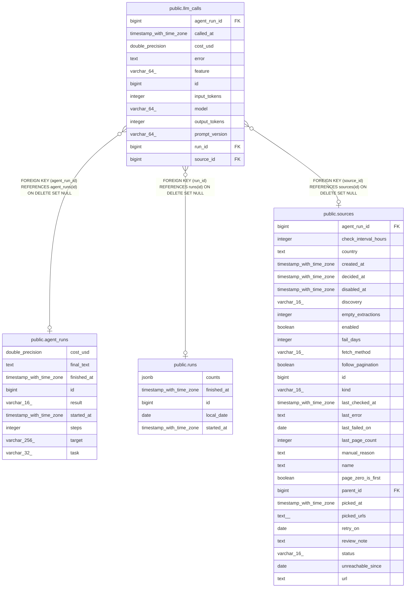

# public.llm_calls

## Columns

| Name | Type | Default | Nullable | Children | Parents | Comment |
| ---- | ---- | ------- | -------- | -------- | ------- | ------- |
| agent_run_id | bigint |  | true |  | [public.agent_runs](public.agent_runs.md) |  |
| called_at | timestamp with time zone | now() | false |  |  |  |
| cost_usd | double precision |  | false |  |  |  |
| error | text |  | true |  |  |  |
| feature | varchar(64) |  | false |  |  |  |
| id | bigint |  | false |  |  |  |
| input_tokens | integer |  | false |  |  |  |
| model | varchar(64) |  | false |  |  |  |
| output_tokens | integer |  | false |  |  |  |
| prompt_version | varchar(64) |  | true |  |  |  |
| run_id | bigint |  | true |  | [public.runs](public.runs.md) |  |
| source_id | bigint |  | true |  | [public.sources](public.sources.md) |  |

## Constraints

| Name | Type | Definition |
| ---- | ---- | ---------- |
| llm_calls_agent_run_id_fkey | FOREIGN KEY | FOREIGN KEY (agent_run_id) REFERENCES agent_runs(id) ON DELETE SET NULL |
| llm_calls_pkey | PRIMARY KEY | PRIMARY KEY (id) |
| llm_calls_run_id_fkey | FOREIGN KEY | FOREIGN KEY (run_id) REFERENCES runs(id) ON DELETE SET NULL |
| llm_calls_source_id_fkey | FOREIGN KEY | FOREIGN KEY (source_id) REFERENCES sources(id) ON DELETE SET NULL |

## Indexes

| Name | Definition |
| ---- | ---------- |
| ix_llm_calls_called_at | CREATE INDEX ix_llm_calls_called_at ON public.llm_calls USING btree (called_at) |
| llm_calls_pkey | CREATE UNIQUE INDEX llm_calls_pkey ON public.llm_calls USING btree (id) |

## Relations

---

> Generated by [tbls](https://github.com/k1LoW/tbls)
