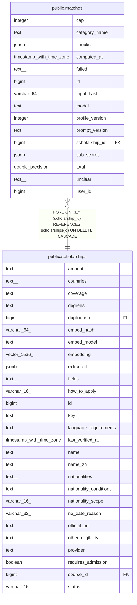

# public.matches

## Columns

| Name | Type | Default | Nullable | Children | Parents | Comment |
| ---- | ---- | ------- | -------- | -------- | ------- | ------- |
| cap | integer |  | true |  |  |  |
| category_name | text |  | false |  |  |  |
| checks | jsonb |  | false |  |  |  |
| computed_at | timestamp with time zone |  | false |  |  |  |
| failed | text[] | '{}'::text[] | false |  |  |  |
| id | bigint |  | false |  |  |  |
| input_hash | varchar(64) |  | true |  |  |  |
| model | text |  | true |  |  |  |
| profile_version | integer |  | false |  |  |  |
| prompt_version | text |  | true |  |  |  |
| scholarship_id | bigint |  | false |  | [public.scholarships](public.scholarships.md) |  |
| sub_scores | jsonb |  | false |  |  |  |
| total | double precision |  | false |  |  |  |
| unclear | text[] | '{}'::text[] | false |  |  |  |
| user_id | bigint |  | false |  |  |  |

## Constraints

| Name | Type | Definition |
| ---- | ---- | ---------- |
| matches_pkey | PRIMARY KEY | PRIMARY KEY (id) |
| matches_scholarship_id_fkey | FOREIGN KEY | FOREIGN KEY (scholarship_id) REFERENCES scholarships(id) ON DELETE CASCADE |
| matches_user_id_scholarship_id_category_name_key | UNIQUE | UNIQUE (user_id, scholarship_id, category_name) |

## Indexes

| Name | Definition |
| ---- | ---------- |
| matches_pkey | CREATE UNIQUE INDEX matches_pkey ON public.matches USING btree (id) |
| matches_user_id_scholarship_id_category_name_key | CREATE UNIQUE INDEX matches_user_id_scholarship_id_category_name_key ON public.matches USING btree (user_id, scholarship_id, category_name) |

## Relations

---

> Generated by [tbls](https://github.com/k1LoW/tbls)
