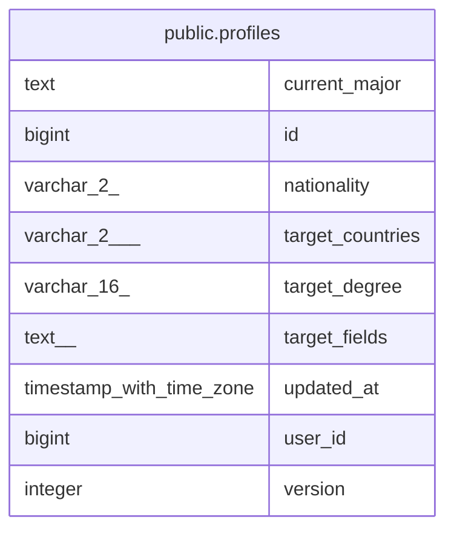

# public.profiles

## Columns

| Name | Type | Default | Nullable | Children | Parents | Comment |
| ---- | ---- | ------- | -------- | -------- | ------- | ------- |
| current_major | text |  | true |  |  |  |
| id | bigint |  | false |  |  |  |
| nationality | varchar(2) |  | false |  |  |  |
| target_countries | varchar(2)[] | '{}'::character varying[] | false |  |  |  |
| target_degree | varchar(16) |  | false |  |  |  |
| target_fields | text[] | '{}'::text[] | false |  |  |  |
| updated_at | timestamp with time zone |  | false |  |  |  |
| user_id | bigint |  | false |  |  |  |
| version | integer | 1 | false |  |  |  |

## Constraints

| Name | Type | Definition |
| ---- | ---- | ---------- |
| profiles_pkey | PRIMARY KEY | PRIMARY KEY (id) |
| profiles_user_id_key | UNIQUE | UNIQUE (user_id) |

## Indexes

| Name | Definition |
| ---- | ---------- |
| profiles_pkey | CREATE UNIQUE INDEX profiles_pkey ON public.profiles USING btree (id) |
| profiles_user_id_key | CREATE UNIQUE INDEX profiles_user_id_key ON public.profiles USING btree (user_id) |

## Relations

---

> Generated by [tbls](https://github.com/k1LoW/tbls)
