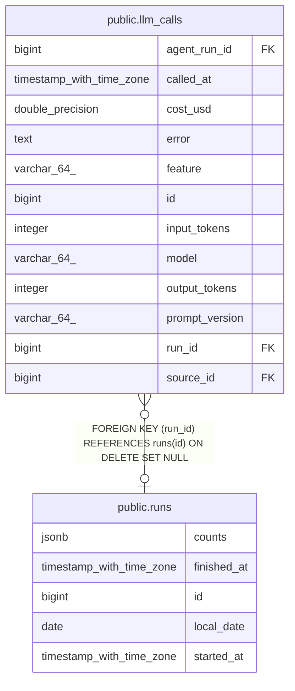

# public.runs

## Columns

| Name | Type | Default | Nullable | Children | Parents | Comment |
| ---- | ---- | ------- | -------- | -------- | ------- | ------- |
| counts | jsonb | '{}'::jsonb | false |  |  |  |
| finished_at | timestamp with time zone |  | true |  |  |  |
| id | bigint |  | false | [public.llm_calls](public.llm_calls.md) |  |  |
| local_date | date |  | false |  |  |  |
| started_at | timestamp with time zone |  | false |  |  |  |

## Constraints

| Name | Type | Definition |
| ---- | ---- | ---------- |
| runs_local_date_key | UNIQUE | UNIQUE (local_date) |
| runs_pkey | PRIMARY KEY | PRIMARY KEY (id) |

## Indexes

| Name | Definition |
| ---- | ---------- |
| runs_local_date_key | CREATE UNIQUE INDEX runs_local_date_key ON public.runs USING btree (local_date) |
| runs_pkey | CREATE UNIQUE INDEX runs_pkey ON public.runs USING btree (id) |

## Relations

---

> Generated by [tbls](https://github.com/k1LoW/tbls)
