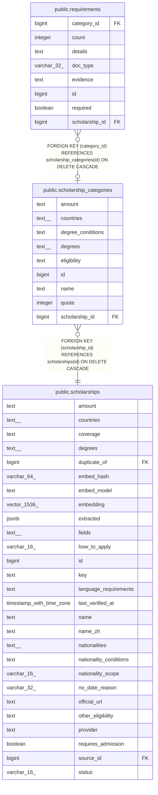

# public.scholarship_categories

## Columns

| Name | Type | Default | Nullable | Children | Parents | Comment |
| ---- | ---- | ------- | -------- | -------- | ------- | ------- |
| amount | text |  | true |  |  |  |
| countries | text[] | '{}'::text[] | false |  |  |  |
| degree_conditions | text |  | true |  |  |  |
| degrees | text[] | '{}'::text[] | false |  |  |  |
| eligibility | text |  | true |  |  |  |
| id | bigint |  | false | [public.requirements](public.requirements.md) |  |  |
| name | text |  | false |  |  |  |
| quota | integer |  | true |  |  |  |
| scholarship_id | bigint |  | false |  | [public.scholarships](public.scholarships.md) |  |

## Constraints

| Name | Type | Definition |
| ---- | ---- | ---------- |
| scholarship_categories_pkey | PRIMARY KEY | PRIMARY KEY (id) |
| scholarship_categories_scholarship_id_fkey | FOREIGN KEY | FOREIGN KEY (scholarship_id) REFERENCES scholarships(id) ON DELETE CASCADE |

## Indexes

| Name | Definition |
| ---- | ---------- |
| scholarship_categories_pkey | CREATE UNIQUE INDEX scholarship_categories_pkey ON public.scholarship_categories USING btree (id) |

## Relations

---

> Generated by [tbls](https://github.com/k1LoW/tbls)
