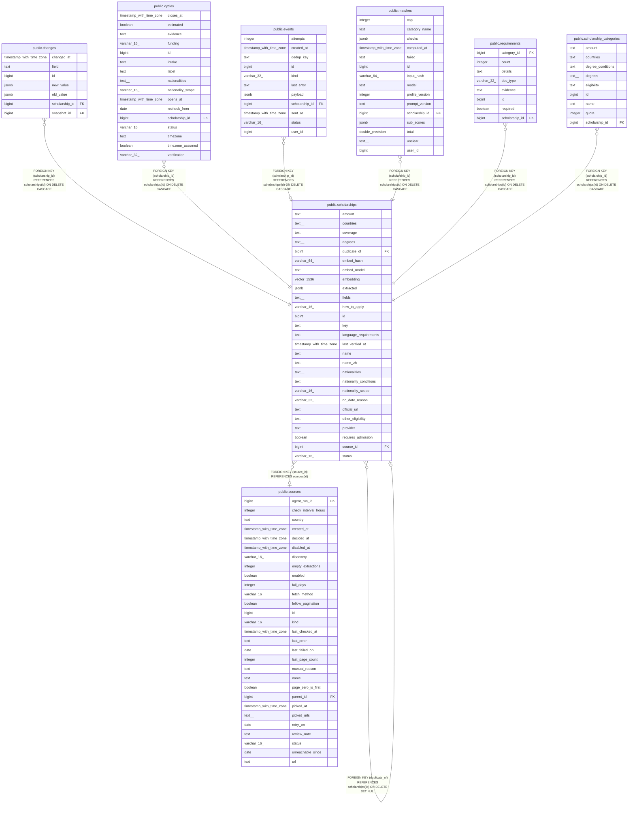

# public.scholarships

## Columns

| Name | Type | Default | Nullable | Children | Parents | Comment |
| ---- | ---- | ------- | -------- | -------- | ------- | ------- |
| amount | text |  | true |  |  |  |
| countries | text[] | '{}'::text[] | false |  |  |  |
| coverage | text |  | true |  |  |  |
| degrees | text[] | '{}'::text[] | false |  |  |  |
| duplicate_of | bigint |  | true |  | [public.scholarships](public.scholarships.md) |  |
| embed_hash | varchar(64) |  | true |  |  |  |
| embed_model | text |  | true |  |  |  |
| embedding | vector(1536) |  | true |  |  |  |
| extracted | jsonb |  | false |  |  |  |
| fields | text[] | '{}'::text[] | false |  |  |  |
| how_to_apply | varchar(16) |  | true |  |  |  |
| id | bigint |  | false | [public.changes](public.changes.md) [public.cycles](public.cycles.md) [public.events](public.events.md) [public.matches](public.matches.md) [public.requirements](public.requirements.md) [public.scholarship_categories](public.scholarship_categories.md) [public.scholarships](public.scholarships.md) |  |  |
| key | text | 'main'::text | false |  |  |  |
| language_requirements | text |  | true |  |  |  |
| last_verified_at | timestamp with time zone |  | true |  |  |  |
| name | text |  | false |  |  |  |
| name_zh | text |  | true |  |  |  |
| nationalities | text[] | '{}'::text[] | false |  |  |  |
| nationality_conditions | text |  | true |  |  |  |
| nationality_scope | varchar(16) | 'unclear'::character varying | false |  |  |  |
| no_date_reason | varchar(32) |  | true |  |  |  |
| official_url | text |  | true |  |  |  |
| other_eligibility | text |  | true |  |  |  |
| provider | text |  | true |  |  |  |
| requires_admission | boolean |  | true |  |  |  |
| source_id | bigint |  | true |  | [public.sources](public.sources.md) |  |
| status | varchar(16) | 'active'::character varying | false |  |  |  |

## Constraints

| Name | Type | Definition |
| ---- | ---- | ---------- |
| scholarships_duplicate_of_fkey | FOREIGN KEY | FOREIGN KEY (duplicate_of) REFERENCES scholarships(id) ON DELETE SET NULL |
| scholarships_pkey | PRIMARY KEY | PRIMARY KEY (id) |
| scholarships_source_id_fkey | FOREIGN KEY | FOREIGN KEY (source_id) REFERENCES sources(id) |
| scholarships_source_id_key_key | UNIQUE | UNIQUE (source_id, key) |

## Indexes

| Name | Definition |
| ---- | ---------- |
| scholarships_pkey | CREATE UNIQUE INDEX scholarships_pkey ON public.scholarships USING btree (id) |
| scholarships_source_id_key_key | CREATE UNIQUE INDEX scholarships_source_id_key_key ON public.scholarships USING btree (source_id, key) |

## Relations

---

> Generated by [tbls](https://github.com/k1LoW/tbls)
