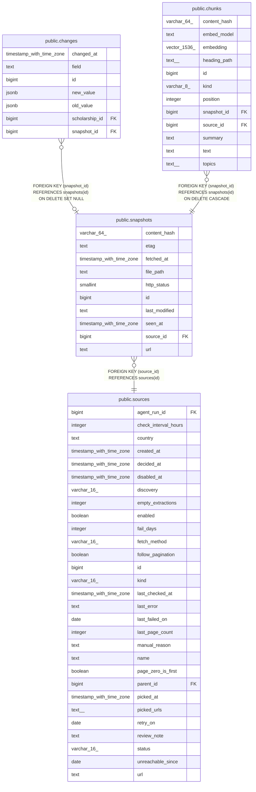

# public.snapshots

## Columns

| Name | Type | Default | Nullable | Children | Parents | Comment |
| ---- | ---- | ------- | -------- | -------- | ------- | ------- |
| content_hash | varchar(64) |  | false |  |  |  |
| etag | text |  | true |  |  |  |
| fetched_at | timestamp with time zone |  | false |  |  |  |
| file_path | text |  | false |  |  |  |
| http_status | smallint |  | false |  |  |  |
| id | bigint |  | false | [public.changes](public.changes.md) [public.chunks](public.chunks.md) |  |  |
| last_modified | text |  | true |  |  |  |
| seen_at | timestamp with time zone |  | true |  |  |  |
| source_id | bigint |  | false |  | [public.sources](public.sources.md) |  |
| url | text |  | false |  |  |  |

## Constraints

| Name | Type | Definition |
| ---- | ---- | ---------- |
| snapshots_pkey | PRIMARY KEY | PRIMARY KEY (id) |
| snapshots_source_id_fkey | FOREIGN KEY | FOREIGN KEY (source_id) REFERENCES sources(id) |

## Indexes

| Name | Definition |
| ---- | ---------- |
| snapshots_pkey | CREATE UNIQUE INDEX snapshots_pkey ON public.snapshots USING btree (id) |

## Relations

---

> Generated by [tbls](https://github.com/k1LoW/tbls)
