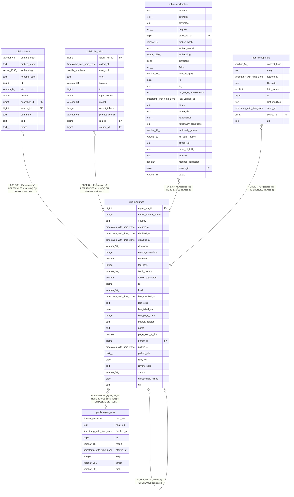

# public.sources

## Columns

| Name | Type | Default | Nullable | Children | Parents | Comment |
| ---- | ---- | ------- | -------- | -------- | ------- | ------- |
| agent_run_id | bigint |  | true |  | [public.agent_runs](public.agent_runs.md) |  |
| check_interval_hours | integer | 24 | false |  |  |  |
| country | text |  | true |  |  |  |
| created_at | timestamp with time zone | now() | false |  |  |  |
| decided_at | timestamp with time zone |  | true |  |  |  |
| disabled_at | timestamp with time zone |  | true |  |  |  |
| discovery | varchar(16) | 'seed'::character varying | false |  |  |  |
| empty_extractions | integer | 0 | false |  |  |  |
| enabled | boolean | true | false |  |  |  |
| fail_days | integer | 0 | false |  |  |  |
| fetch_method | varchar(16) | 'html'::character varying | false |  |  |  |
| follow_pagination | boolean | false | false |  |  |  |
| id | bigint |  | false | [public.chunks](public.chunks.md) [public.llm_calls](public.llm_calls.md) [public.scholarships](public.scholarships.md) [public.snapshots](public.snapshots.md) [public.sources](public.sources.md) |  |  |
| kind | varchar(16) |  | false |  |  |  |
| last_checked_at | timestamp with time zone |  | true |  |  |  |
| last_error | text |  | true |  |  |  |
| last_failed_on | date |  | true |  |  |  |
| last_page_count | integer |  | true |  |  |  |
| manual_reason | text |  | true |  |  |  |
| name | text |  | false |  |  |  |
| page_zero_is_first | boolean | false | false |  |  |  |
| parent_id | bigint |  | true |  | [public.sources](public.sources.md) |  |
| picked_at | timestamp with time zone |  | true |  |  |  |
| picked_urls | text[] | '{}'::text[] | false |  |  |  |
| retry_on | date |  | true |  |  |  |
| review_note | text |  | true |  |  |  |
| status | varchar(16) | 'approved'::character varying | false |  |  |  |
| unreachable_since | date |  | true |  |  |  |
| url | text |  | false |  |  |  |

## Constraints

| Name | Type | Definition |
| ---- | ---- | ---------- |
| sources_agent_run_id_fkey | FOREIGN KEY | FOREIGN KEY (agent_run_id) REFERENCES agent_runs(id) ON DELETE SET NULL |
| sources_parent_id_fkey | FOREIGN KEY | FOREIGN KEY (parent_id) REFERENCES sources(id) |
| sources_pkey | PRIMARY KEY | PRIMARY KEY (id) |
| sources_url_key | UNIQUE | UNIQUE (url) |

## Indexes

| Name | Definition |
| ---- | ---------- |
| sources_pkey | CREATE UNIQUE INDEX sources_pkey ON public.sources USING btree (id) |
| sources_url_key | CREATE UNIQUE INDEX sources_url_key ON public.sources USING btree (url) |

## Relations

---

> Generated by [tbls](https://github.com/k1LoW/tbls)
