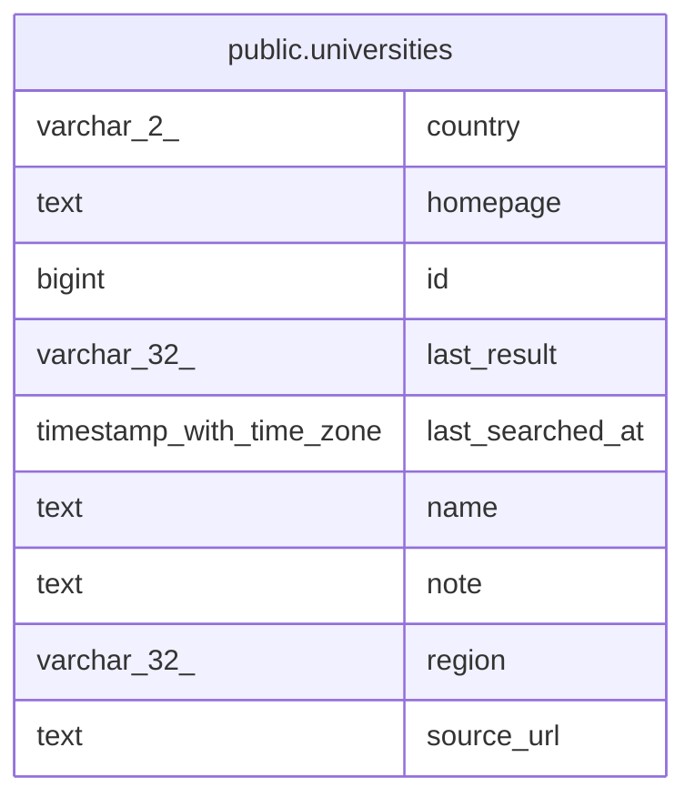

# public.universities

## Columns

| Name | Type | Default | Nullable | Children | Parents | Comment |
| ---- | ---- | ------- | -------- | -------- | ------- | ------- |
| country | varchar(2) |  | false |  |  |  |
| homepage | text |  | false |  |  |  |
| id | bigint |  | false |  |  |  |
| last_result | varchar(32) |  | true |  |  |  |
| last_searched_at | timestamp with time zone |  | true |  |  |  |
| name | text |  | false |  |  |  |
| note | text |  | true |  |  |  |
| region | varchar(32) |  | true |  |  |  |
| source_url | text |  | false |  |  |  |

## Constraints

| Name | Type | Definition |
| ---- | ---- | ---------- |
| universities_homepage_key | UNIQUE | UNIQUE (homepage) |
| universities_pkey | PRIMARY KEY | PRIMARY KEY (id) |

## Indexes

| Name | Definition |
| ---- | ---------- |
| universities_homepage_key | CREATE UNIQUE INDEX universities_homepage_key ON public.universities USING btree (homepage) |
| universities_pkey | CREATE UNIQUE INDEX universities_pkey ON public.universities USING btree (id) |

## Relations

---

> Generated by [tbls](https://github.com/k1LoW/tbls)
